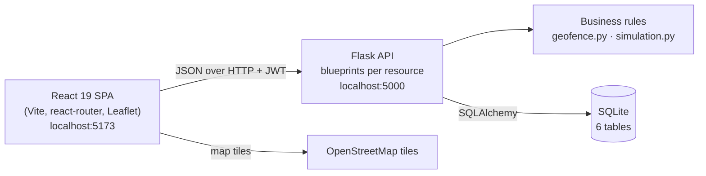

# FieldTrack — Dispatch & Time Tracking

FieldTrack is the **administrative (office) side** of a dispatch and time-tracking system for a
construction services company. Dispatchers schedule jobs at geolocated job sites and assign
crews without double-booking anyone; supervisors record GPS-stamped time entries, which are
**automatically flagged when the clock-in or clock-out location is outside the job site's
geofence**, and approve or reject them with a reason. Reports summarise hours by worker and by
job with CSV export for payroll, and a Live Map shows every site and (simulated) worker
positions across the Kathmandu Valley.

Built for **PRG 100 — Systems Analysis & Design**: the analysis and design artifacts in
[`docs/`](docs/) come first, and the working system implements them.

> Presenting the project live? See **[DEMO.md](DEMO.md)** for the day-of checklist and the
> 9-step demo script.

## Features

| Area | What it does |
|------|--------------|
| **Sign-in and roles** | Admin, Dispatcher and Supervisor accounts sign in with email and password (bcrypt) and receive an 8-hour JWT. Every API route checks the role (HTTP 403 otherwise). Workers are records only and cannot sign in. |
| **Dashboard** | Today's KPIs (active jobs, workers clocked in, hours today, flagged entries), today's jobs, a *Needs attention* list (flagged entries, understaffed jobs, overnight shifts) and unassigned workers. |
| **Job sites** | Name, address, coordinates and a geofence radius (25–5000 m, default 200 m). |
| **Jobs and crews** | Create and edit jobs; assign workers. A worker can hold **one assignment per day** — a second one is refused with HTTP 409 naming the existing job. |
| **Time entries** | Record clock-in/out with GPS coordinates. Time can only be recorded on a job the worker is assigned to that day; overlapping entries are refused; shifts may cross midnight. Entries outside the geofence are **saved and flagged** with a reason. |
| **Approvals** | Supervisors approve or reject completed entries with a mandatory reason; the approver is recorded as an audit trail. |
| **Reports** | Hours by worker (approved vs pending) and by job for any date range, flagged entries, and CSV export. Hours are always computed from clock-in/out, never stored. |
| **People** | Admins create, edit and deactivate staff and workers (deactivated rather than deleted, so history stays intact). |
| **Live Map** | Job sites with geofence circles and worker markers that commute, slow down at real traffic junctions and arrive on site. Positions are simulated from the server clock — see [docs/live-map-design.md](docs/live-map-design.md). |

Every validation error comes back as `{"error": "...", "field": "..."}` and is shown directly
under the field it refers to.

## Architecture



- **Backend** (`backend/`): a Flask application factory registers one blueprint per resource
  (users, sites, jobs, assignments, time entries, reports, dashboard, map). Business rules live
  in small, testable places: `geofence.py` (pure haversine/flag functions), model methods such
  as `TimeEntry.apply_geofence()` and `TimeEntry.hours()`, and `simulation.py` for the Live Map.
  A `UNIQUE(user_id, work_date)` constraint backs up the double-booking rule in the database.
- **Frontend** (`frontend/`): one fetch wrapper (`api/client.js`) attaches the JWT and turns
  server errors into `{message, field}`; pages use shared table, modal, form-field and state
  components styled with design tokens (no UI library).
- **Data**: six tables — users, job_sites, jobs, assignments, time_entries, location_pings
  (see the [ERD](docs/erd.md) and [data dictionary](docs/data-dictionary.md)).

| Key rule | Where it lives |
|----------|----------------|
| **Geofence** — distance > site radius ⇒ entry is saved *and* flagged | `backend/geofence.py`, `TimeEntry.apply_geofence()` in `backend/models.py` |
| **Double-booking** — one assignment per worker per day, else HTTP 409 | `backend/routes/assignments.py` + `UNIQUE(user_id, work_date)` in `models.py` |
| **Assignment rule** — time can only be recorded on a job the worker is assigned to that day | `backend/routes/time_entries.py` |
| **Computed hours** — never stored; `clock_out − clock_in` (works across midnight) | `TimeEntry.hours()` in `models.py` |

**Why flag instead of block?** GPS drifts, people clock in from the site trailer, and the
company must pay for time actually worked — so an off-site entry is kept and a supervisor
decides. **Why can't double-booking slip through?** The API checks first (to name the clashing
job), and the database constraint catches the case where two dispatchers click at the same
instant.

## Tech stack

| Layer | Technology |
|-------|------------|
| Backend | Python 3.10+, Flask 3, Flask-SQLAlchemy, Flask-JWT-Extended, Flask-CORS, bcrypt, python-dotenv, SQLite |
| Frontend | React 19, Vite, react-router-dom, Leaflet + react-leaflet, plain CSS with design tokens |
| Quality | pytest (54 tests), black, Prettier |
| Docs | Markdown + Mermaid diagrams in `docs/` |

## Setup

Requires **Python 3.10+** and **Node.js 20+**. Use two terminals, both starting in the project
folder.

### Terminal 1 — backend

**Windows (PowerShell):**
```powershell
cd backend
python -m venv .venv
.venv\Scripts\Activate.ps1
pip install -r requirements.txt
python seed.py
python app.py
```
If PowerShell refuses to run `Activate.ps1`, run
`Set-ExecutionPolicy -Scope Process RemoteSigned` first (affects this window only).

**macOS / Linux:**
```bash
cd backend
python3 -m venv .venv
source .venv/bin/activate
pip install -r requirements.txt
python seed.py
python app.py
```

The API is now on http://localhost:5000 (health check: http://localhost:5000/api/health).
`python seed.py` creates the SQLite database at `backend/instance/fieldtrack.db` and loads the
demo data. **Run it before the first sign-in** — without it there are no accounts.

### Terminal 2 — frontend

```bash
cd frontend
npm install
npm run dev
```

Open **http://localhost:5173** and sign in with one of the demo accounts below (the login page
has click-to-fill buttons).

| Role | Email | Password |
|------|-------|----------|
| Admin | `admin@fieldtrack.com` | `Admin123!` |
| Dispatcher | `dispatch@fieldtrack.com` | `Dispatch123!` |
| Dispatcher | `dispatch2@fieldtrack.com` | `Dispatch123!` |
| Supervisor | `supervisor@fieldtrack.com` | `Super123!` |

Workers (e.g. Marcus Reyes, Ben Okafor) are records only and cannot sign in.

### Configuration

Nothing needs configuring to run locally. To change a setting, copy `backend/.env.example` to
`backend/.env` (or set environment variables):

| Variable | Default | Purpose |
|----------|---------|---------|
| `SECRET_KEY` / `JWT_SECRET_KEY` | a local development key | Signs login tokens — **set a long random value anywhere but your own machine** |
| `DATABASE_URL` | `sqlite:///fieldtrack.db` | Database location |
| `JWT_EXPIRES_HOURS` | `8` | How long a sign-in lasts |
| `CORS_ORIGINS` | `http://localhost:5173,http://127.0.0.1:5173` | Browser origins allowed to call the API |
| `HOST` / `PORT` | `127.0.0.1` / `5000` | Where `python app.py` listens |
| `FLASK_DEBUG` | off | `1` enables auto-reload and interactive tracebacks while developing |

The frontend reads `VITE_API_URL` (default `http://127.0.0.1:5000`) — see
`frontend/.env.example`.

### Tests and formatting

```bash
cd backend
pytest                           # 54 tests
pip install -r requirements-dev.txt
black --check .

cd ../frontend
npm run build                    # production build
npm run format:check             # Prettier
```

The tests cover the haversine maths and the 199 m / 201 m flag boundary, shifts across
midnight, double-booking, the assignment and overlap rules, approvals and their audit trail,
bcrypt storage, expired and tampered tokens, a wrong-role 403 on every restricted route, edge
cases sent straight to the API (bad geofence radius, clock-out not after clock-in, an empty
database), and the Live Map simulation (repeatable routes, the 1.3× route rule, someone always
moving, traffic slowdown, read-only endpoint).

### Reset the data

`python seed.py` (from `backend/`, with the virtualenv active) wipes and reloads everything.
Seed dates are **relative to today** — jobs run yesterday, today and tomorrow — so re-run it on
the day you present.

## Project structure

```
FieldTrack/
├── README.md               This file
├── DEMO.md                 Day-of checklist and the 9-step demo script
├── docs/                   Analysis & design artifacts (see below)
├── backend/
│   ├── app.py              Flask app factory, blueprints, JSON error handlers
│   ├── config.py           Settings from environment variables / .env
│   ├── models.py           6 SQLAlchemy models
│   ├── auth.py             login, /me, @role_required decorator
│   ├── geofence.py         haversine() and should_flag() — pure functions
│   ├── kathmandu_geo.py    valley bounds, landmarks, traffic hotspots
│   ├── simulation.py       simulated worker GPS (pure, clock-based: no writes, no threads)
│   ├── validation.py       server-side input validation helpers
│   ├── routes/             users, sites, jobs, assignments, time_entries, reports, dashboard, map
│   ├── seed.py             resets the DB and loads demo data (dates relative to today)
│   └── tests/              test_rules.py, test_security.py, test_map.py
└── frontend/
    └── src/
        ├── api/            fetch wrapper + useApi hook
        ├── context/        AuthContext + ProtectedRoute
        ├── components/     Sidebar, TopBar, KpiCard, StatusChip, DataTable, Modal, FormField…
        ├── pages/          Login, Dashboard, Jobs, LiveMap, JobSites, Crew, TimeEntries, Reports
        └── styles/         tokens.css (design tokens), global.css, live-map.css
```

## Documentation

| Document | Contents |
|----------|----------|
| [requirements.md](docs/requirements.md) | Problem statement, roles, functional and non-functional requirements, user stories, traceability |
| [dfd.md](docs/dfd.md) | Context diagram and level-0 data flow diagram |
| [use-cases.md](docs/use-cases.md) | Use case diagram and the fully dressed "Record and approve a time entry" use case |
| [erd.md](docs/erd.md) | Entity relationship diagram and relationship notes |
| [data-dictionary.md](docs/data-dictionary.md) | Every field: type, size, validation rule, example |
| [class-diagram.md](docs/class-diagram.md) | Model classes, the geofence and simulation modules |
| [decision-table.md](docs/decision-table.md) | The clock-in decision table (assignment, overlap, geofence) |
| [api-spec.md](docs/api-spec.md) | Every endpoint: role, body, responses, errors |
| [live-map-design.md](docs/live-map-design.md) | Why and how the Live Map is simulated |
| [development-notes.md](docs/development-notes.md) | How the project was planned and built, and the key decisions |

## Course learning outcomes

How the project provides evidence for the PRG 100 course learning outcomes (CLOs).

> **To complete:** replace each ‹placeholder› with the official CLO wording from the course
> outline. The evidence column is accurate as written.

| CLO | Evidence in this project |
|-----|--------------------------|
| ‹CLO — requirements / problem analysis› | [requirements.md](docs/requirements.md): problem statement, stakeholders, FR/NFR tables, user stories with traceability |
| ‹CLO — process and data modelling› | [dfd.md](docs/dfd.md), [erd.md](docs/erd.md), [data-dictionary.md](docs/data-dictionary.md), [class-diagram.md](docs/class-diagram.md) |
| ‹CLO — behaviour and business-rule modelling› | [use-cases.md](docs/use-cases.md) (fully dressed UC7 with alternate flows), [decision-table.md](docs/decision-table.md) |
| CLO 3 — ‹project management wording› | [development-notes.md](docs/development-notes.md): re-planning and scope decisions; the commit history |
| ‹CLO — implementation and testing› | The working system, [api-spec.md](docs/api-spec.md), 54 automated tests |

## Known limitations and future work

These are deliberate scope decisions for a one-term, administrative-side project, not missing
pieces of it.

- **No worker mobile app.** Workers are records; supervisors enter time on their behalf.
  A mobile app for self clock-in is the natural next component.
- **No real GPS feed.** Coordinates are entered (or filled by "simulate phone GPS" buttons), and
  the Live Map simulates positions. The API and map are shaped so a real feed could replace the
  simulation without changing the UI.
- **No payroll integration.** Approved hours export as CSV for import; a direct integration
  with a payroll provider is future work.
- **Local deployment only.** SQLite and the Flask/Vite development servers suit a single
  machine. Production would use a managed database, a WSGI server behind HTTPS, a built
  frontend, and a real `SECRET_KEY` (already supported via environment variables).
- **No password reset, notifications or multi-company support.**
- **Map routes are straight segments between landmarks**, not snapped to the road network.
