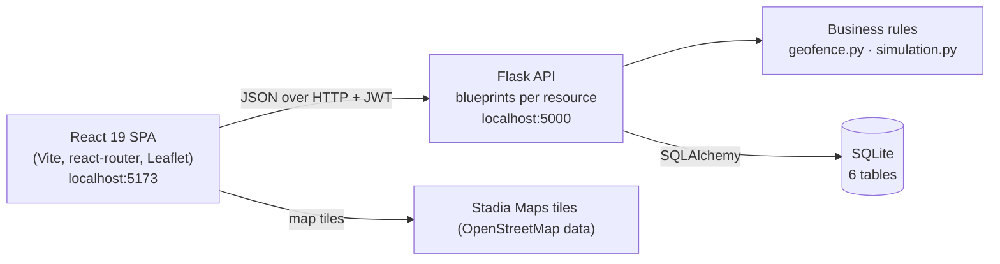

# FieldTrack — Dispatch & Time Tracking

FieldTrack is the **administrative (office) side** of a dispatch and time-tracking system for a
construction services company. Dispatchers schedule jobs at geolocated job sites and assign
crews without double-booking anyone; supervisors record GPS-stamped time entries, which are
**automatically flagged when the clock-in or clock-out location is outside the job site's
geofence**, and approve or reject them with a reason. Reports summarise hours by worker and by
job with CSV export for payroll, and a Live Map shows every site and (simulated) worker
positions across the Kathmandu Valley.

Built for **PRG 100 — Systems Analysis & Design**: the analysis and design artifacts in
[`docs/`](docs/) come first, and the working system implements them.

> Presenting the project live? See **[DEMO.md](DEMO.md)** for the day-of checklist and the
> 9-step demo script.

## Features

| Area | What it does |
|------|--------------|
| **Sign-in and roles** | Admin, Dispatcher and Supervisor accounts sign in with email and password (bcrypt) and receive an 8-hour JWT. Every API route checks the role (HTTP 403 otherwise). Workers are records only and cannot sign in. |
| **Dashboard** | Today's KPIs (active jobs, workers clocked in, hours today, flagged entries), today's jobs, a *Needs attention* list (flagged entries, understaffed jobs, overnight shifts) and unassigned workers. |
| **Job sites** | Name, address, coordinates and a geofence radius (25–5000 m, default 200 m). |
| **Jobs and crews** | Create and edit jobs; assign workers. A worker can hold **one assignment per day** — a second one is refused with HTTP 409 naming the existing job. |
| **Time entries** | Record clock-in/out with GPS coordinates. Time can only be recorded on a job the worker is assigned to that day; overlapping entries are refused; shifts may cross midnight. Entries outside the geofence are **saved and flagged** with a reason. |
| **Approvals** | Supervisors approve or reject completed entries with a mandatory reason; the approver is recorded as an audit trail. |
| **Reports** | Hours by worker (approved vs pending) and by job for any date range, flagged entries, and CSV export. Hours are always computed from clock-in/out, never stored. |
| **People** | Admins create, edit and deactivate staff and workers (deactivated rather than deleted, so history stays intact). |
| **Light and dark mode** | A sun/moon button in the top bar (and on the sign-in page) switches theme. It follows the operating-system setting until you choose, then remembers the choice. The Live Map switches to a matching light or dark base map. |
| **Live Map** | Job sites with geofence circles and worker markers that commute, slow down at real traffic junctions and arrive on site. Positions are simulated from the server clock — see [docs/live-map-design.md](docs/live-map-design.md). |

Every validation error comes back as `{"error": "...", "field": "..."}` and is shown directly
under the field it refers to.

## Architecture



- **Backend** (`backend/`): a Flask application factory registers one blueprint per resource
  (users, sites, jobs, assignments, time entries, reports, dashboard, map). Business rules live
  in small, testable places: `geofence.py` (pure haversine/flag functions), model methods such
  as `TimeEntry.apply_geofence()` and `TimeEntry.hours()`, and `simulation.py` for the Live Map.
  A `UNIQUE(user_id, work_date)` constraint backs up the double-booking rule in the database.
- **Frontend** (`frontend/`): one fetch wrapper (`api/client.js`) attaches the JWT and turns
  server errors into `{message, field}`; pages use shared table, modal, form-field and state
  components styled with design tokens (no UI library).
- **Data**: six tables — users, job_sites, jobs, assignments, time_entries, location_pings
  (see the [ERD](docs/erd.md) and [data dictionary](docs/data-dictionary.md)).

| Key rule | Where it lives |
|----------|----------------|
| **Geofence** — distance > site radius ⇒ entry is saved *and* flagged | `backend/geofence.py`, `TimeEntry.apply_geofence()` in `backend/models.py` |
| **Double-booking** — one assignment per worker per day, else HTTP 409 | `backend/routes/assignments.py` + `UNIQUE(user_id, work_date)` in `models.py` |
| **Assignment rule** — time can only be recorded on a job the worker is assigned to that day | `backend/routes/time_entries.py` |
| **Computed hours** — never stored; `clock_out − clock_in` (works across midnight) | `TimeEntry.hours()` in `models.py` |

**Why flag instead of block?** GPS drifts, people clock in from the site trailer, and the
company must pay for time actually worked — so an off-site entry is kept and a supervisor
decides. **Why can't double-booking slip through?** The API checks first (to name the clashing
job), and the database constraint catches the case where two dispatchers click at the same
instant.

## Tech stack

| Layer | Technology |
|-------|------------|
| Backend | Python 3.10+, Flask 3, Flask-SQLAlchemy, Flask-JWT-Extended, Flask-CORS, bcrypt, python-dotenv, SQLite |
| Frontend | React 19, Vite, react-router-dom, Leaflet + react-leaflet with Stadia Maps tiles (English labels), plain CSS with design tokens (light and dark themes) |
| Quality | pytest (630+ tests, ~98% line coverage), Vitest (70 tests), black, Prettier, GitHub Actions CI |
| Docs | Markdown + Mermaid diagrams in `docs/` |

## Setup

Requires **Python 3.10+** (suite run locally on 3.10, 3.12 and 3.13 on Linux, and on 3.13 on Windows; the CI matrix covers the same three) and **Node.js 22.22.2+ or 24.15+** (the test tooling's
DOM, jsdom 30, cannot load on Node 20; `npm ci` warns if your Node is too old). Use two terminals, both starting in the project
folder.

### Terminal 1 — backend

**Windows (PowerShell):**
```powershell
cd backend
python -m venv .venv
.venv\Scripts\Activate.ps1
pip install -r requirements.txt
python seed.py
python app.py
```
If PowerShell refuses to run `Activate.ps1`, run
`Set-ExecutionPolicy -Scope Process RemoteSigned` first (affects this window only).

**macOS / Linux:**
```bash
cd backend
python3 -m venv .venv
source .venv/bin/activate
pip install -r requirements.txt
python seed.py
python app.py
```

The API is now on http://localhost:5000 (health check: http://localhost:5000/api/health).
`python seed.py` creates the SQLite database at `backend/instance/fieldtrack.db` and loads the
demo data into it. **Run it before the first sign-in** — without it there are no accounts.
It only fills an *empty* database: if data already exists it changes nothing and says so.

> **Check `DATABASE_URL` first.** The app uses it if it is set in your shell or `backend/.env`. A
> value left over from another project (for example a `postgresql://` URL) makes FieldTrack fail
> to start. Clear it for this terminal with `Remove-Item Env:DATABASE_URL` (PowerShell) or
> `unset DATABASE_URL`.

### Terminal 2 — frontend

```bash
cd frontend
npm install
npm run dev
```

Open **http://localhost:5173** and sign in with one of the demo accounts below (the login page
has click-to-fill buttons).

| Role | Email | Password |
|------|-------|----------|
| Admin | `admin@fieldtrack.com` | `Admin123!` |
| Dispatcher | `dispatch@fieldtrack.com` | `Dispatch123!` |
| Dispatcher | `dispatch2@fieldtrack.com` | `Dispatch123!` |
| Supervisor | `supervisor@fieldtrack.com` | `Super123!` |

Workers (e.g. Ramesh Karki, Bishal Neupane) are records only and cannot sign in.

### Configuration

Nothing needs configuring to run locally. To change a setting, copy `backend/.env.example` to
`backend/.env` (or set environment variables):

| Variable | Default | Purpose |
|----------|---------|---------|
| `APP_ENV` | `development` | `development`, `test` or `production`. **Production refuses to start** without a strong `SECRET_KEY` (≥ 32 characters, not a placeholder) and refuses `FLASK_DEBUG=1`. A mistyped value is an error, never a silent fallback |
| `SECRET_KEY` / `JWT_SECRET_KEY` | a built-in key, **development only** | Signs login tokens. Required in production — generate with `python -c "import secrets; print(secrets.token_hex(32))"` |
| `LOGIN_MAX_FAILURES_PER_ACCOUNT` / `_PER_CLIENT` / `LOGIN_RATE_WINDOW_SECONDS` | `5` / `20` / `300` | Failed logins allowed per window before HTTP 429 |
| `SAFETY_PERSISTENCE` | on | Save safety state in the database (restored at start-up) |
| `LOGIN_MAX_FAILURES_PER_ACCOUNT_TOTAL` | `25` | Failures for one email from all addresses together before HTTP 429 (the per-address limit stays 5) |
| `SAFETY_TICKER_ENABLED` / `SAFETY_TICK_INTERVAL_SECONDS` | on / `1` | The backend heartbeat that advances safety escalation (started by `python app.py` and `wsgi.py`, never by tests) |
| `MAX_REQUEST_BYTES` | `1048576` | Largest request body (HTTP 413 above it) |
| `SQLITE_BUSY_TIMEOUT_SECONDS` | `10` | How long a database write waits for another write before the API answers 503 `Retry-After: 1` |
| `TRUSTED_PROXY_COUNT` | `0` | Reverse proxies to trust for the client address (needed for correct rate limiting behind a proxy) |
| `HSTS_ENABLED` | off | Send `Strict-Transport-Security` (only over HTTPS) |
| `DATABASE_URL` | `sqlite:///fieldtrack.db` | Database location |
| `JWT_EXPIRES_HOURS` | `8` | How long a sign-in lasts |
| `CORS_ORIGINS` | `http://localhost:5173,http://127.0.0.1:5173` | Browser origins allowed to call the API |
| `HOST` / `PORT` | `127.0.0.1` / `5000` | Where `python app.py` listens |
| `FLASK_DEBUG` | off | `1` enables auto-reload and interactive tracebacks while developing |

The frontend reads `VITE_API_URL` (default `http://127.0.0.1:5000`) — see
`frontend/.env.example`.

### Tests and formatting

```bash
cd backend
pip install -r requirements-dev.txt
pytest                           # 630+ tests
pytest --cov                     # with a coverage report (CI requires >= 85%)
black --check .

cd ../frontend
npm test                         # Vitest smoke tests (sign-in, dashboard, errors, roles)
npm run build                    # production build
npm run format:check             # Prettier
```

GitHub Actions (`.github/workflows/ci.yml`) runs the same checks on every push and pull request:
`black --check`, `pytest --cov`, `prettier --check`, `vitest` and the production build. The tests
use an in-memory database and never touch `backend/instance/fieldtrack.db`.

The tests cover the haversine maths and the 199 m / 201 m flag boundary, shifts across
midnight, double-booking, the assignment and overlap rules, approvals and their audit trail,
bcrypt storage, expired and tampered tokens, a wrong-role 403 on every restricted route, edge
cases sent straight to the API (bad geofence radius, clock-out not after clock-in, an empty
database), and the Live Map simulation (repeatable routes, the 1.3× route rule, someone always
moving, traffic slowdown, read-only endpoint).

### Reset the data

Plain `python seed.py` is safe to run any time: it never deletes anything and does nothing if the
database already holds data. To wipe the local database and reload the demo data:

```bash
python seed.py --reset --yes     # without --yes it asks you to type RESET
```

The reset is refused when `APP_ENV=production` and for any database that is not SQLite, so a stray
`DATABASE_URL` can never make it erase someone else's data. Seed dates are **relative to today**
— jobs run yesterday, today and tomorrow — so use `--reset --yes` on the day you present.

## Safety / emergency (man-down) alerts

The Live Map also watches every simulated worker for trouble. A worker who is **on shift** but
**has not moved** for the idle threshold gets a safety check-in; unanswered check-ins escalate to
an EMERGENCY that only a supervisor can close. Every state-changing safety control (trigger an
accident, SOS, "I'm OK", break, resolve, return to duty) is limited to **Supervisors and Admins** by the
server; a Dispatcher can watch the map, alerts and audit log but gets HTTP 403 on any control.
**Escalation is advanced by the backend, not by browsers.** A heartbeat thread started by `python app.py`
(or `wsgi.py`) computes the Live Map state and feeds the safety state machine once a second, so check-ins and
emergencies keep escalating with every browser tab closed. The Live Map page only *reads* (`GET /api/map/live`),
and warns on screen if the server says monitoring is not running or has gone stale.
`POST /api/safety/tick` still exists as a manual "advance now" for tests and tooling. Everything is simulated: nobody is called or
texted (the notifier is a mock, see below).

```
NORMAL -> CHECKIN_1 -> CHECKIN_2 -> CHECKIN_3 -> EMERGENCY -> (supervisor resolves)
            ^ back to NORMAL if the worker replies "I'm OK" or starts moving
```

- **Check-in 1** messages the worker *and* raises a warning for the supervisor; check-ins 2 and 3
  message the worker again. Each has its own response window.
- **EMERGENCY** sets the worker's status to `EMERGENCY` (not offline: the marker stays, pulses red
  and keeps showing the last known location), places a **mock** call to emergency services, alerts
  the supervisor at critical level and locks until a supervisor picks *Resolved - real incident* or
  *Resolved - false alarm* (optional note).
  A false alarm returns the worker to NORMAL; a real incident marks them **Post-incident** (kept
  visible, not re-escalated) until a supervisor presses *Return to duty*.
- **Never flagged:** workers who are off shift (not started / off duty), marked *on break*, or standing
  inside a configured break zone.
- **Accidents:** each moving worker rolls `accident_probability` (1%) once per
  `accident_roll_interval_seconds` (one simulated hour = 400 s), not every tick. A victim stops
  moving and never answers, so the escalation above follows. Fine-but-idle workers (for instance
  those standing on site) answer with probability `auto_respond_chance`, so false alarms get cleared.
- **SOS:** skips straight to EMERGENCY.
- **Audit log:** every event (idle detected, each check-in, replies, accident, SOS, mock call,
  resolution and note) is timestamped; view it in the *Audit log* tab or export CSV/JSON.
- **Privacy:** location data is used only for safety alerts, and the reason for any flag is visible
  to the worker (the check-in message states it). The panel repeats this note.

### Configuration

One preset switch, `SAFETY_MODE` (environment variable or `backend/.env`):

| Setting (`SAFETY_<NAME>` overrides any one) | `real` | `demo` |
|---|---|---|
| `IDLE_THRESHOLD_SECONDS` | 600 | 15 |
| `CHECKIN_RESPONSE_WINDOW_SECONDS` | 120 | 5 |
| `NUM_CHECKINS` | 3 | 3 |
| `ACCIDENT_PROBABILITY` | 0.01 | 0.01 |
| `ACCIDENT_ROLL_INTERVAL_SECONDS` | 400 (one simulated hour) | 400 |
| `AUTO_RESPOND_CHANCE` | 0.85 | 0.85 |
| `IDLE_DISTANCE_TOLERANCE_M` | 15 | 15 |
| `MAX_POLL_GAP_SECONDS` | 10 | 10 |

`SAFETY_SEED=<integer>` makes accidents and auto-replies reproducible (otherwise a random seed is
used and reported in `GET /api/safety/config`). Break zones (circles or rectangles) are defined in
`backend/safety/config.py` (`DEFAULT_BREAK_ZONES`). All durations are real seconds.

### Run the demo

```
cd backend
SAFETY_MODE=demo SAFETY_SEED=1 python app.py          # PowerShell: $env:SAFETY_MODE="demo"; python app.py
cd ../frontend && npm run dev                          # open Live Map; keep it open (it drives the clock)
```

1. Sign in and open **Live Map**; the Safety panel above the map shows *All clear* and the mode.
2. Click a worker marker and press **Trigger accident** (or **SOS**). In demo mode: 15 s later
   check-in 1 (warning + message), then check-ins 2 and 3 five seconds apart, then EMERGENCY with a
   mock call. Watch the *Messages* and *Audit log* tabs.
3. In the *Alerts* tab, see the location, elapsed time and nearest available co-worker, then press
   **Resolved - false alarm** or **real incident**.
4. To see a false alarm clear: leave workers standing on site; they are idle, get a check-in and
   usually answer "I'm OK" automatically. In the *Messages* tab you can also answer as the worker.

Replacing the mock: subclass `Notifier` in `backend/safety/notifier.py` (for example a Twilio SMS and
voice adapter) and pass it to `SafetyService(notifier=...)`; nothing else changes. No new
dependencies were added.

## Project structure

```
FieldTrack/
├── README.md               This file
├── DEMO.md                 Day-of checklist and the 9-step demo script
├── docs/                   Analysis & design artifacts (see below)
├── backend/
│   ├── app.py              Flask app factory, blueprints, JSON error handlers
│   ├── config.py           Settings from environment variables / .env
│   ├── models.py           6 SQLAlchemy models
│   ├── auth.py             login, /me, @role_required decorator
│   ├── geofence.py         haversine() and should_flag() — pure functions
│   ├── kathmandu_geo.py    valley bounds, landmarks, traffic hotspots
│   ├── simulation.py       simulated worker GPS (pure, clock-based: no writes, no threads)
│   ├── validation.py       server-side input validation helpers
│   ├── routes/             users, sites, jobs, assignments, time_entries, reports, dashboard, map
│   ├── seed.py             resets the DB and loads demo data (dates relative to today)
│   └── tests/              test_rules.py, test_security.py, test_map.py
└── frontend/
    └── src/
        ├── api/            fetch wrapper + useApi hook
        ├── context/        AuthContext + ProtectedRoute
        ├── components/     Sidebar, TopBar, KpiCard, StatusChip, DataTable, Modal, FormField…
        ├── pages/          Login, Dashboard, Jobs, LiveMap, JobSites, Crew, TimeEntries, Reports
        └── styles/         tokens.css (design tokens), global.css, live-map.css
```

## Documentation

| Document | Contents |
|----------|----------|
| [requirements.md](docs/requirements.md) | Problem statement, roles, functional and non-functional requirements, user stories, traceability |
| [dfd.md](docs/dfd.md) | Context diagram and level-0 data flow diagram |
| [use-cases.md](docs/use-cases.md) | Use case diagram and the fully dressed "Record and approve a time entry" use case |
| [erd.md](docs/erd.md) | Entity relationship diagram and relationship notes |
| [data-dictionary.md](docs/data-dictionary.md) | Every field: type, size, validation rule, example |
| [class-diagram.md](docs/class-diagram.md) | Model classes, the geofence and simulation modules |
| [decision-table.md](docs/decision-table.md) | The clock-in decision table (assignment, overlap, geofence) |
| [api-spec.md](docs/api-spec.md) | Every endpoint: role, body, responses, errors |
| [live-map-design.md](docs/live-map-design.md) | Why and how the Live Map is simulated |
| [development-notes.md](docs/development-notes.md) | How the project was planned and built, and the key decisions |

## Course learning outcomes

How the project provides evidence for the PRG 100 course learning outcomes (CLOs).

> **To complete:** replace each ‹placeholder› with the official CLO wording from the course
> outline. The evidence column is accurate as written.

| CLO | Evidence in this project |
|-----|--------------------------|
| ‹CLO — requirements / problem analysis› | [requirements.md](docs/requirements.md): problem statement, stakeholders, FR/NFR tables, user stories with traceability |
| ‹CLO — process and data modelling› | [dfd.md](docs/dfd.md), [erd.md](docs/erd.md), [data-dictionary.md](docs/data-dictionary.md), [class-diagram.md](docs/class-diagram.md) |
| ‹CLO — behaviour and business-rule modelling› | [use-cases.md](docs/use-cases.md) (fully dressed UC7 with alternate flows), [decision-table.md](docs/decision-table.md) |
| CLO 3 — ‹project management wording› | [development-notes.md](docs/development-notes.md): re-planning and scope decisions; the commit history |
| ‹CLO — implementation and testing› | The working system, [api-spec.md](docs/api-spec.md), 630+ automated backend tests and 70 frontend tests |

## Known limitations and future work

These are deliberate scope decisions for a one-term, administrative-side project, not missing
pieces of it.

- **No worker mobile app and no worker sign-in.** The requirements deliberately limit FieldTrack to the
  office side ("Workers are managed as records; they do not log in", [requirements.md](docs/requirements.md)),
  so supervisors enter time on their behalf and workers cannot clock themselves in. Self-service would need:
  a worker credential and a `Worker`-role token, endpoints that take the worker from the token (never from
  the request body) and reuse the existing assignment, overlap and geofence rules, and a mobile or
  phone-friendly client. None of that is half-built; it is a Phase 2 project.
- **Safety monitoring is simulated; its open state is durable.** Check-ins, emergencies, post-incident holds, the
  audit log and the message feed are saved in the database after every change and restored when the server starts
  (`SAFETY_PERSISTENCE`, default on), so a crash or restart does not lose an emergency. Not saved: idle time a
  worker had built up *before* check-in 1 (that timer restarts). While the server is down nothing escalates, and
  there is no external watchdog. Escalation does not need a browser (backend heartbeat), only a running server.
  Retention of audit records is an open decision (requirements §7.3).
- **No real GPS feed.** Coordinates are entered (or filled by "simulate phone GPS" buttons), and
  the Live Map simulates positions. The API and map are shaped so a real feed could replace the
  simulation without changing the UI.
- **No payroll integration.** Approved hours export as CSV for import; a direct integration
  with a payroll provider is future work.
- **Local deployment only** — see *Deployment notes* below.
- **No password reset, notifications or multi-company support.** Passwords are limited to 72 bytes (bcrypt).
- **Simplified map routing.** Simulated workers follow the real main roads, but routing ignores
  one-way streets and road class.
- **Map tiles need a key once hosted.** Stadia Maps serves the base map without a key on
  `localhost` only; a deployment needs a free Stadia account registered to its domain.

## Deployment notes

What is verified and what is not, so nobody assumes more than exists.

- **Development (what this repo is tested for):** Flask development server + SQLite file +
  `npm run dev`. `APP_ENV` defaults to `development`, with a built-in signing key.
- **Production needs:** `APP_ENV=production` and a random `SECRET_KEY` (startup fails otherwise);
  a WSGI server (for example gunicorn or waitress) behind HTTPS; `HSTS_ENABLED=1`; `CORS_ORIGINS` set
  to the real site; `TRUSTED_PROXY_COUNT` set to the number of proxies in front of the app; the built
  frontend (`npm run build`) served as static files.
- **Run ONE server process.** Safety state is now saved in the database, and only the process holding the database
  lease runs the heartbeat, but each process still keeps its own working copy and its own login rate limiter, so a
  second process would serve stale map/alert data and multiply the login limit. With several worker processes each would keep its
  own copy and run its own heartbeat, so alerts would disagree and the login limit would be multiplied by the
  worker count. Use one process (threads are fine), e.g. `gunicorn -w 1 --threads 4 wsgi:app` (an example only: no production WSGI server has been tested with this project), until that state
  moves to a shared store such as the database or Redis. Do not read the rate limit as process-wide
  protection otherwise.
- **Concurrent writes (SQLite).** "No overlapping clock-ins" and "crew not full" are check-then-write rules. The
  routes that enforce them take SQLite's write lock first (`BEGIN IMMEDIATE`, see `backend/concurrency.py`), which
  works across threads *and* processes, and a partial unique index guarantees one open entry per worker. A write
  that cannot get the lock within `SQLITE_BUSY_TIMEOUT_SECONDS` returns HTTP 503 (`Retry-After: 1`) without
  changing anything. Another database would need row locks instead; none is supported today.
- **Request limits and a reverse proxy.** The app refuses bodies over `MAX_REQUEST_BYTES` (413) and malformed,
  over-nested or non-UTF-8 input (400). Put the same limit in front of it as well (for example nginx
  `client_max_body_size 1m;`) so oversized requests never reach Python.
- **Live Map coverage.** Routes are simulated on the committed Kathmandu Valley road network. A job site more
  than 5 km from any road point (see `MAX_SNAP_M` in `backend/roads.py`) is *unsupported*: it stays in the data
  and on the site list, the API still accepts it, but its workers are shown as "Route unavailable" and the map
  warns instead of hanging.
- **Database:** SQLite is fine for one machine and one process. The app creates tables with
  `create_all` (there are no migrations) and only the SQLite driver is installed; moving to PostgreSQL
  means adding a driver, testing against it and adding a migration tool. The destructive `seed.py --reset`
  deliberately refuses non-SQLite databases.
- **Frontend CSP:** the API sends a locked-down Content-Security-Policy, but the React app is served by
  whatever hosts the built files, which must set its own (allow scripts and styles from itself, images and
  connections to the Stadia tile host and to the API origin).
- **Performance (not verified for production):** on the seeded data every endpoint answered in about
  2-15 ms (median), with the lazy-loaded Live Map the first page downloads about 99 kB gzipped. Some list
  endpoints load related rows one at a time (for example crew per job); that is fine at this size and is the
  first thing to look at if lists grow into the thousands.
