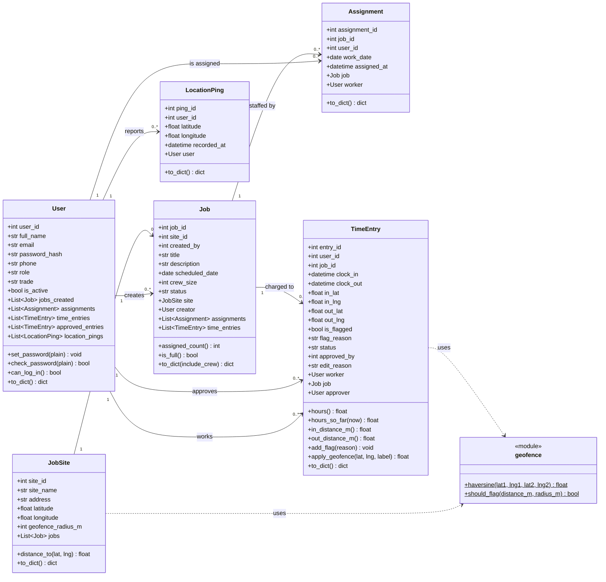

# FieldTrack — Class Diagram

The SQLAlchemy model classes in `backend/models.py`, plus the pure-function `geofence`
module they use. Relationships are declared in both directions (`back_populates`).

## Method notes

| Class | Method | Purpose |
|-------|--------|---------|
| User | `set_password` / `check_password` | bcrypt hash and verify; the plain password is never stored. |
| User | `can_log_in` | True only for active Admin, Dispatcher or Supervisor accounts with a password. |
| JobSite | `distance_to(lat, lng)` | Haversine distance in metres from the site to a coordinate. |
| Job | `assigned_count` / `is_full` | Crew-size check used before creating an assignment. |
| TimeEntry | `hours` | `(clock_out − clock_in)` in hours; `None` while clocked in. Works across midnight because it subtracts full datetimes, not times. |
| TimeEntry | `hours_so_far(now)` | Hours for open entries up to `now` — used for "hours logged today". |
| TimeEntry | `apply_geofence(lat, lng, label)` | **The geofence rule**: haversine distance from the job site; if `should_flag(distance, radius)` it calls `add_flag` with e.g. "Clock-in 500 m from site (limit 200 m)". The entry is always kept. |
| TimeEntry | `add_flag(reason)` | Sets `is_flagged` and appends a reason (clock-in and clock-out can both add one). |
