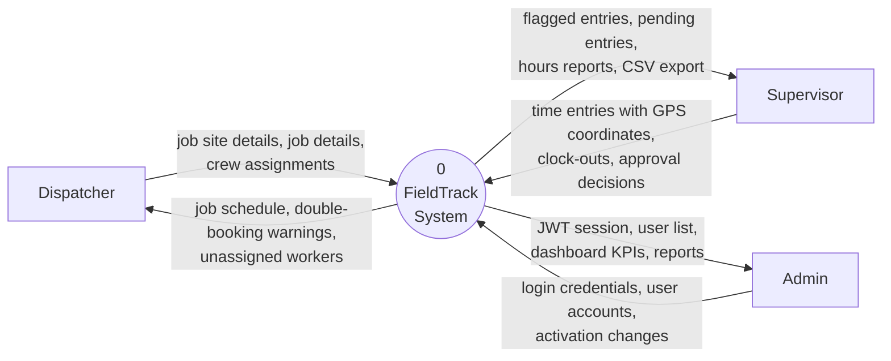
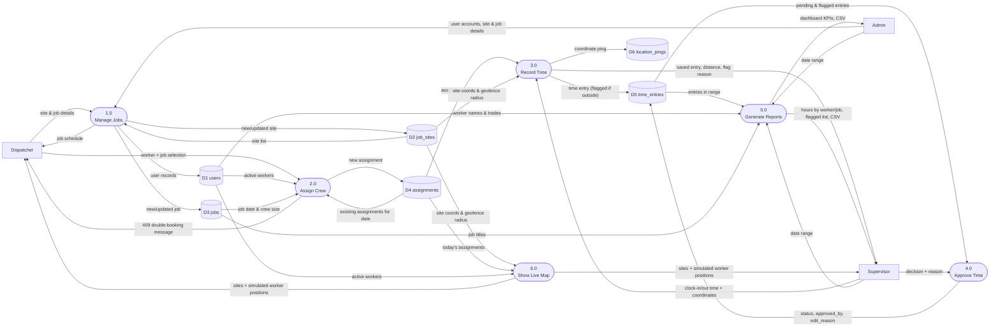

# FieldTrack — Data Flow Diagrams

Notation used below: **rectangles** are external entities, **rounded shapes** are processes,
**cylinders** are data stores (D1–D6, one per database table).

## 1. Context Diagram (Level-0 context)

The whole system is a single process. It shows everything that crosses the system boundary.

## 2. Level-0 DFD

The system decomposed into its six major processes and six data stores.

## 3. Process Descriptions

| Process | Input | Logic | Output |
|---------|-------|-------|--------|
| 1.0 Manage Jobs | Site and job details from the Dispatcher; user accounts from the Admin | Validate fields (coordinates in range, crew size 1–50, valid status, unique email). At level 0, maintaining the people and places that jobs need is treated as part of managing jobs. | Rows in D1 `users`, D2 `job_sites` and D3 `jobs` |
| 2.0 Assign Crew | Worker, job, work date | Worker must be active; crew not full; **worker has no other assignment that date** (double-booking rule) | Row in D4 `assignments`, or a 409 message |
| 3.0 Record Time | Worker, job, times, coordinates | Worker must be **assigned to that job that day**; no overlap; haversine distance to site; flag if distance > radius; always save | Row in D5 `time_entries` + rows in D6 `location_pings` |
| 4.0 Approve Time | Entry id, decision, reason | Entry must be Pending and clocked out; reason required | Updated status/approver in D5 |
| 5.0 Generate Reports | Date range | Sum computed hours (clock_out − clock_in), excluding rejected entries | Report tables and CSV file |
| 6.0 Show Live Map | Server clock | For each worker assigned today, compute a deterministic commute and the position at the current simulated time; read-only | Site pins with geofences and worker markers (no data store is written) |
