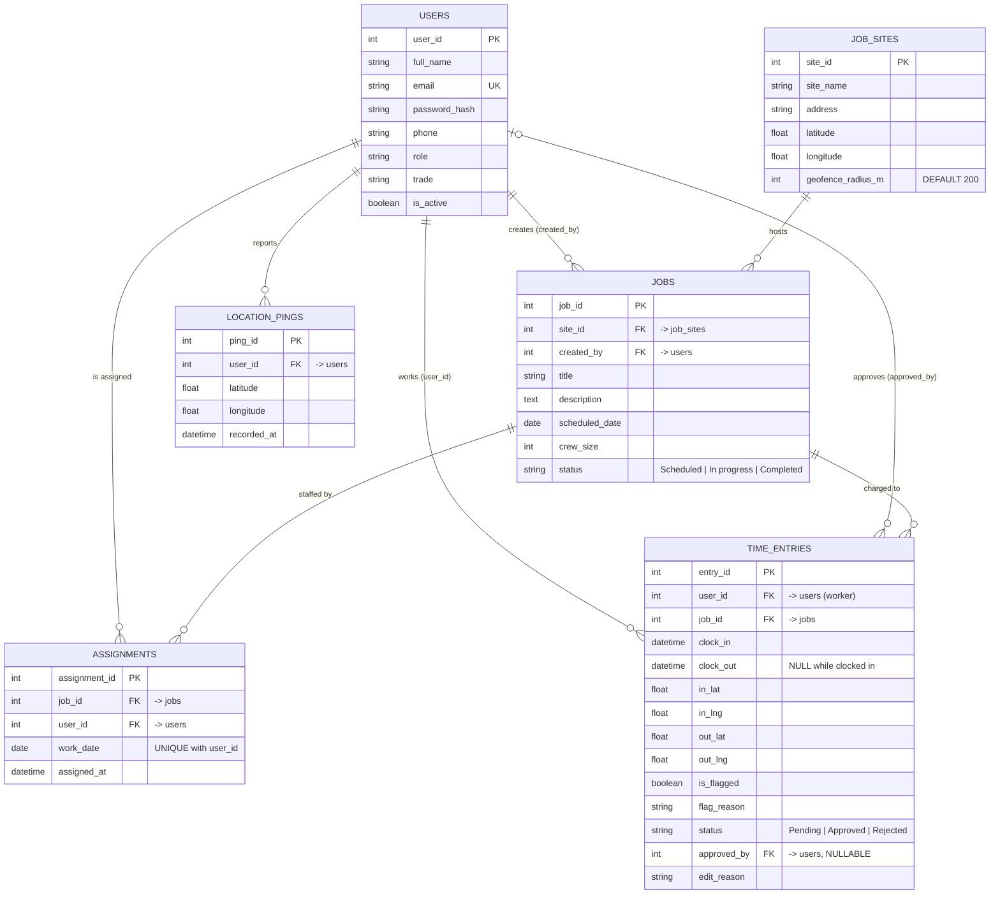

# FieldTrack — Entity Relationship Diagram

## Relationship notes

| Relationship | Cardinality | Explanation |
|--------------|-------------|-------------|
| job_sites → jobs | 1 : 0..N | A site can host many jobs over time; every job is at exactly one site. |
| users → jobs (created_by) | 1 : 0..N | The dispatcher/admin who created the job. |
| jobs → assignments | 1 : 0..N | A job is staffed by up to `crew_size` assignments. |
| users → assignments | 1 : 0..N | **At most one per work_date** — enforced by `UNIQUE(user_id, work_date)`; this is the double-booking rule at the database level. |
| users → time_entries (user_id) | 1 : 0..N | The worker whose time it is. |
| users → time_entries (approved_by) | 0..1 : 0..N | The supervisor who approved/rejected; NULL while Pending. |
| jobs → time_entries | 1 : 0..N | The job the time is charged to. |
| users → location_pings | 1 : 0..N | Every coordinate captured at clock-in/clock-out is logged as a ping for audit. |

**Normalisation:** all tables are in 3NF. No derived values are stored — in particular
*hours worked* is computed as `clock_out − clock_in` and *distance from site* is computed from
the stored coordinates on demand.
