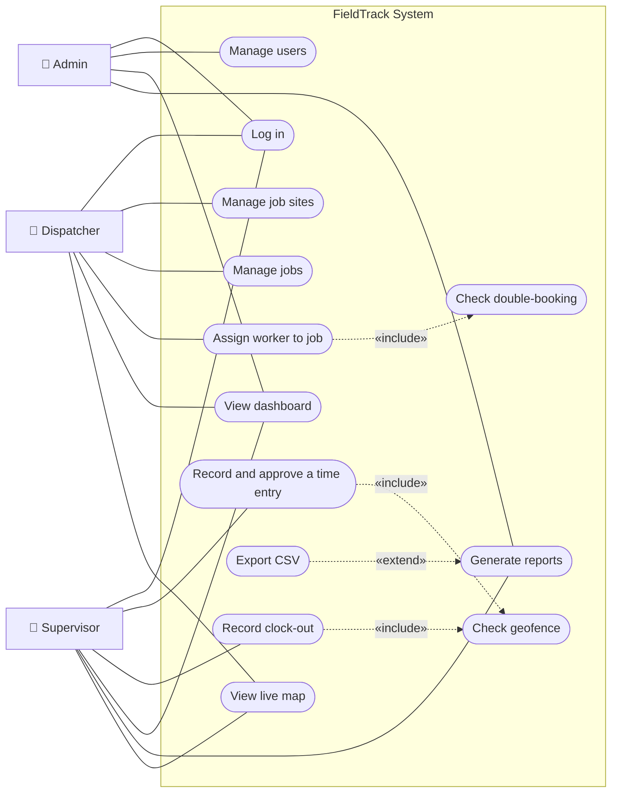

# FieldTrack — Use Cases

## 1. Use Case Diagram

Mermaid has no native UML use-case notation, so actors are drawn as stick-figure labels and
use cases as ovals (stadium shapes) inside the system boundary.

*Admin inherits every staff capability; only the Admin-specific associations are drawn to
keep the diagram readable. UC13 shows simulated positions until a mobile app supplies real GPS
(see [live-map-design.md](live-map-design.md)).*

## 2. Fully Dressed Use Case — UC7 "Record and approve a time entry"

| Field | Description |
|-------|-------------|
| **Use case ID** | UC7 |
| **Name** | Record and approve a time entry |
| **Primary actor** | Supervisor (an Admin may also perform it) |
| **Stakeholders** | Worker (wants to be paid correctly), Payroll (wants verified hours), Company (wants proof workers were on site) |
| **Trigger** | A worker reports their shift start/end to the supervisor with the GPS location from their phone. |
| **Preconditions** | 1. The Supervisor is logged in with a valid JWT. 2. The worker exists and is active. 3. The job exists at a job site that has coordinates and a geofence radius. |
| **Postconditions (success)** | A time entry exists with status *Approved* or *Rejected*, the approver's id and the reason recorded; if the entry was outside the geofence it carries `is_flagged = true` and a `flag_reason`. Location pings are stored for every coordinate captured. |
| **Includes** | UC8 Check geofence |

### Main success flow

1. Supervisor opens **Time Entries** and selects **Record time entry**.
2. System displays the form: worker, job, clock-in, optional clock-out, clock-in latitude/longitude, optional clock-out latitude/longitude.
3. Supervisor selects the worker and job, enters the clock-in time and coordinates, and submits.
4. System validates that all required fields are present and that coordinates are in range.
5. System confirms the worker has an **assignment for this job on the clock-in date**.
6. System confirms the entry does **not overlap** another entry for the same worker.
7. System computes the haversine distance between the clock-in coordinates and the job site (**UC8**). Distance is within the geofence radius, so the entry is not flagged.
8. System saves the entry with status *Pending*, stores a location ping, and shows the entry in the list with its computed distance.
9. At the end of the shift, the Supervisor selects **Clock out** on the entry and enters clock-out time and coordinates.
10. System validates that clock-out is after clock-in (a shift that crosses midnight is valid), checks the geofence again (**UC8**), and saves the clock-out. Hours are now computed as clock-out − clock-in.
11. Supervisor selects **Approve**, types a reason (e.g. "Verified with site foreman"), and confirms.
12. System checks the entry is *Pending* and clocked out, sets status to *Approved*, records `approved_by` and `edit_reason`, and refreshes the list.

### Alternate flows

| Ref | Condition | Handling |
|-----|-----------|----------|
| **4a** | A required field is missing or a coordinate is out of range. | System returns 400 with the offending `field`; the form shows the message under that field. Supervisor corrects and resubmits (resume at step 4). |
| **5a** | Worker is **not assigned** to that job on that date. | System returns 409 "*<Worker> is not assigned to <Job> on <date>*". Nothing is saved. The Supervisor asks the Dispatcher to assign the worker first (UC5), then retries. |
| **6a** | Entry **overlaps** an existing entry for the worker. | System returns 409 naming the conflicting entry. Nothing is saved. |
| **7a** | Clock-in location is **outside the geofence**. | System still saves the entry (step 8) but sets `is_flagged = true` and `flag_reason` = "*Clock-in 512 m from site (limit 200 m)*". The row is highlighted amber and appears in the dashboard's *Needs Attention* list. |
| **10a** | Clock-out time is **not after** clock-in. | System returns 400 with `field = clock_out`; nothing is saved. |
| **10b** | Clock-out location is outside the geofence. | Clock-out is saved and the entry is flagged; the reason is appended to any existing flag reason. |
| **10c** | Entry has already been clocked out. | System returns 409 "*This entry has already been clocked out.*" |
| **11a** | Supervisor decides to **reject** (e.g. worker was not on site). | Supervisor selects **Reject** and enters a reason. System sets status *Rejected*, records approver and reason. Rejected hours are excluded from reports. |
| **11b** | Reason is left blank. | System returns 400 with `field = edit_reason`; the modal shows "A reason is required for the audit trail." before anything is sent. |
| **12a** | Entry is still open (no clock-out) or already decided. | System returns 400 / 409 respectively and the decision is not saved. |
| **\*a** | JWT is expired or the user lacks the Supervisor/Admin role. | System returns 401 / 403; the UI returns to the login page or shows the permission error. |

### Business rules referenced
- **BR-1 Assignment rule:** time can only be recorded against a job the worker is assigned to on that date.
- **BR-2 Geofence rule:** distance > radius ⇒ flag; entries are *never* discarded for location — the supervisor decides.
- **BR-3 Computed hours:** hours are never stored; they are computed from clock-in and clock-out.
- **BR-4 Audit:** every decision stores who made it and why.

---

## UC14 — Monitor workers and handle a safety emergency (added 2026-10-11)

*Written from the implemented behaviour; see requirements FR-14 … FR-24. Roles and open decisions: requirements §7.*

| Item | Description |
|------|-------------|
| **Actors** | Supervisor or Admin (acts), Dispatcher (watches), the server heartbeat (automatic), the simulated worker |
| **Precondition** | At least one worker is assigned today and shown on the Live Map; the server is running with the heartbeat on |
| **Trigger** | A worker on shift stops moving, or a Supervisor presses SOS / Trigger accident in the demo |
| **Postcondition** | The incident is resolved with an outcome and note in the audit log, or remains open and visible |

### Main flow
1. The server sees a worker on shift stay within 15 m for the idle threshold and sends check-in 1 and a supervisor warning.
2. The worker does not answer; after each window check-in 2 and 3 follow.
3. After the last window the server declares EMERGENCY: critical alert, a **mock** call, status EMERGENCY. All of this is saved.
4. A Supervisor opens the Live Map, sees the alert (location, nearest available co-worker, elapsed time), and chooses *Resolved - false alarm* or *Resolved - real incident* with an optional note.
5. For a real incident the worker is held *Post-incident*; later a Supervisor presses *Return to duty*.

### Alternate flows
| Ref | Condition | Handling |
|-----|-----------|----------|
| 2a | The worker answers "I'm OK" or starts moving | The check-in is cleared and idle timing restarts. |
| 3a | **The server restarts** after step 1 or 3 | State is restored; the schedule continues; nothing is repeated. |
| 3b | The database cannot be written | Memory keeps the state; the Live Map warns; each second the save is retried. |
| 4a | A Dispatcher tries to resolve | 403; nothing changes. |
| 4b | The resolution cannot be saved | 503 "could not be saved"; the emergency stays open. |
| 4c | Two supervisors resolve at once | One succeeds; the other gets 409 "not in an emergency". |
| \*a | The job site is outside the supported road network | The worker is shown as "Route unavailable" and is not monitored; a warning is shown. |
